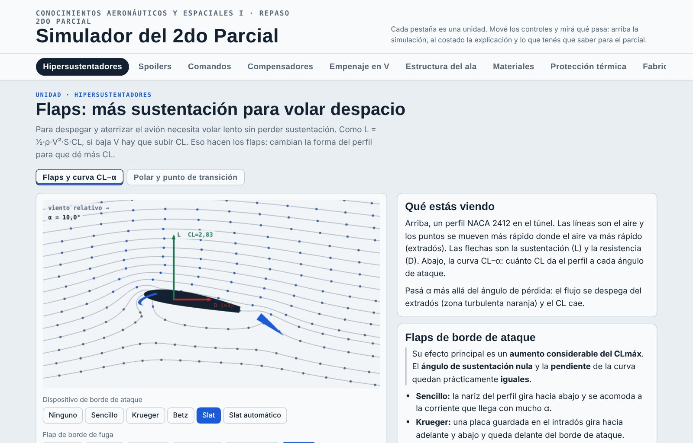

<div align="center">

# ✈️ AeroSim · Ingeniería Aeroespacial

**Simulador interactivo para estudiar Conocimientos Aeronáuticos y Espaciales I**

Mové los controles, mirá qué pasa y repasá lo que entra en el 2do parcial.

[](https://craken06.github.io/aerosim-ingenieria-aeroespacial/)




</div>

---

## ¿Qué es?

AeroSim es una página web con **11 unidades** de la materia **Conocimientos Aeronáuticos y Espaciales I** (UTN FRH, Ingeniería Aeroespacial). Cada unidad tiene tres partes:

- 🎛️ **Una simulación** que se maneja con sliders, botones y hasta una palanca de mando.
- 📖 **La explicación del tema**, con lo que dice el PPT de la cátedra.
- 🎯 **Un recuadro "Para el parcial"** con lo que hay que saber de memoria.

No hay que instalar nada: es HTML, CSS y JavaScript puro, dibujado sobre `<canvas>`.

## Unidades

| Pestaña | Qué se simula |
|---|---|
| **Hipersustentadores** | Flujo sobre un perfil NACA 2412 con flaps de borde de ataque (sencillo, Krueger, Betz), **slats** (comandados y automáticos) y flaps de borde de fuga (sencillo, ranurado, de intradós, acharnelado, Fowler). Curva CL–α, polar y punto de transición M. |
| **Spoilers** | Control lateral, aerofreno en vuelo y carrera de aterrizaje con y sin spoilers. |
| **Comandos** | Alerones, timón de profundidad y de dirección; ala delta sin cola con elevones. |
| **Compensadores** | Compensación por cornadura desprotegida y protegida, con la fuerza en la palanca. |
| **Empenaje en V** | Fuerzas en cada plano y torsión en el fuselaje frente a una cola clásica. |
| **Estructura del ala** | Componentes principales y secundarios; flexión, corte y momento flector con el factor de carga. |
| **Materiales** | Designación SAE, fuselaje reticulado de acero 4130, tratamientos térmicos, aluminio 2024-T3 y 7075-T6, compuestos (vidrio, carbono, Kevlar), curado de resina y paneles sándwich. |
| **Protección térmica** | Reentrada con RCC, HRSI y AFRSI; materiales ablativos y ensayo ASTM E285; mantas MLI en órbita; ensayo de vacío térmico. |
| **Fabricación** | Las 9 etapas, desde los requerimientos hasta el comportamiento en servicio. |
| **Tsiolkovsky** | Ecuación del cohete, con y sin pérdidas por gravedad. |
| **Etapas y órbitas** | Lanzador de 1 etapa contra 2 etapas; velocidad orbital, período y ΔV para distintas órbitas. |

## Cómo usarlo

### Online

Abrí la demo: **https://craken06.github.io/aerosim-ingenieria-aeroespacial/**

### En tu computadora

```bash
git clone https://github.com/craken06/aerosim-ingenieria-aeroespacial.git
cd aerosim-ingenieria-aeroespacial
```

Después hacé doble clic en `index.html`. Si preferís un servidor local:

```bash
python -m http.server 8000
# abrí http://localhost:8000
```

Podés enlazar directo a una unidad con el hash de la URL, por ejemplo `index.html#tsio` o `index.html#tps`.

## Características

- **Sin dependencias ni build**: se abre y funciona.
- **Tema claro y oscuro** automático según el sistema.
- **Responsive**: en el celular la explicación pasa debajo de la simulación.
- **Accesible**: navegación por teclado, la palanca de mando se mueve con las flechas, respeta `prefers-reduced-motion`.
- **Eficiente**: solo se anima la pestaña que estás viendo.
- **Recuerda dónde estabas**: vuelve a la última unidad que abriste.

## Estructura del proyecto

```
index.html                    la página (las 11 unidades)
css/estilos.css               colores, tipografías, tema claro/oscuro y layout
js/nucleo.js                  utilidades comunes: canvas, dibujo, controles, pestañas, bucle
js/<unidad>.js                una simulación por unidad
js/inicio.js                  arranca todo al cargar la página
apuntes/Repaso_2do_Parcial.md el PPT de repaso pasado a texto
img/captura.jpg               captura para este README
PROYECTO.md                   documentación completa de cómo está hecho
```

Cada módulo de `js/` se registra con `register(id, { init, frame })` y el núcleo ejecuta el `frame` solo del módulo activo. Los detalles del código y de cada modelo físico están en [`PROYECTO.md`](PROYECTO.md).

## Apuntes

[`apuntes/Repaso_2do_Parcial.md`](apuntes/Repaso_2do_Parcial.md) tiene el PPT de la cátedra convertido a texto, con índice de los 16 temas.

## Notas

- Los modelos son **simplificados** y usan valores típicos de bibliografía. Sirven para entender cómo se comporta cada cosa, **no para dimensionar**.
- El contenido teórico está basado en el PPT *"Repaso 2do Parcial — Materiales + Proceso de Fabricación"* de la cátedra (UTN FRH, Rev. 0 2025). Los slats se agregaron aparte porque el PPT no los incluye.
- Las tipografías se cargan de Google Fonts; sin internet la página funciona igual con las del sistema.

## Autor

Hecho por [**@craken06**](https://github.com/craken06) para estudiar Ingeniería Aeroespacial en la UTN.
